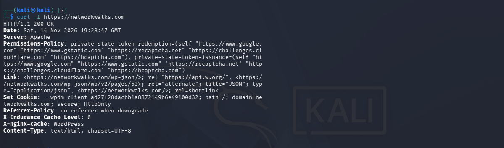
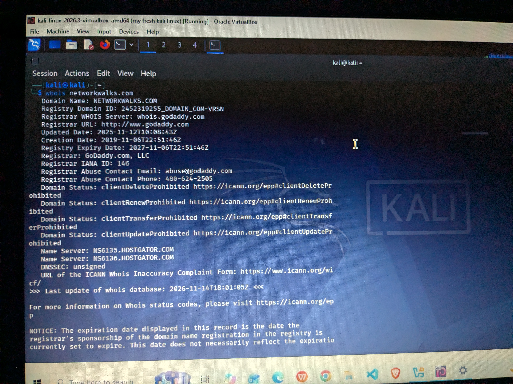
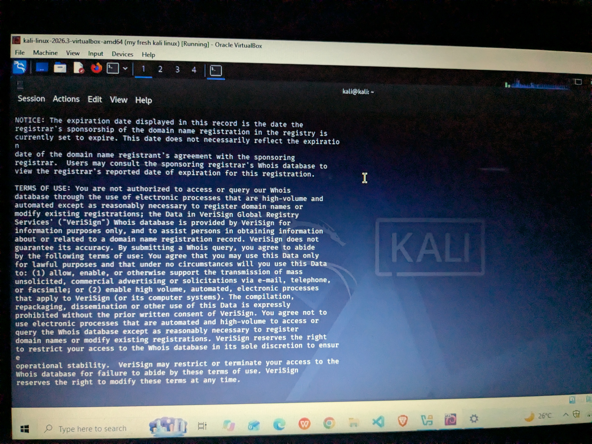
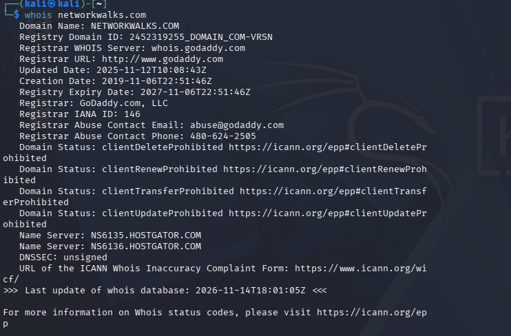
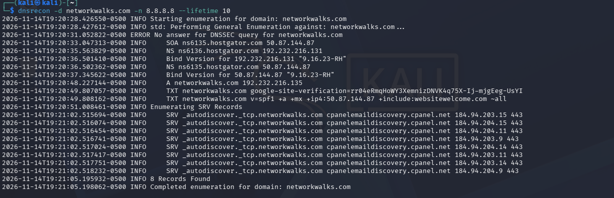
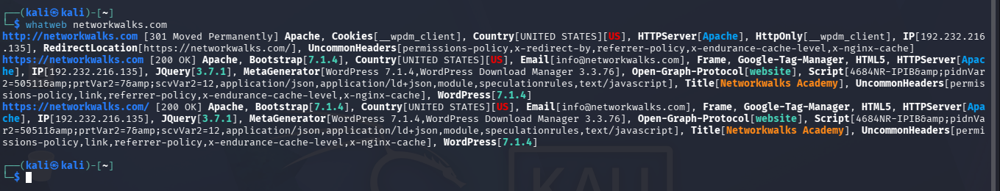
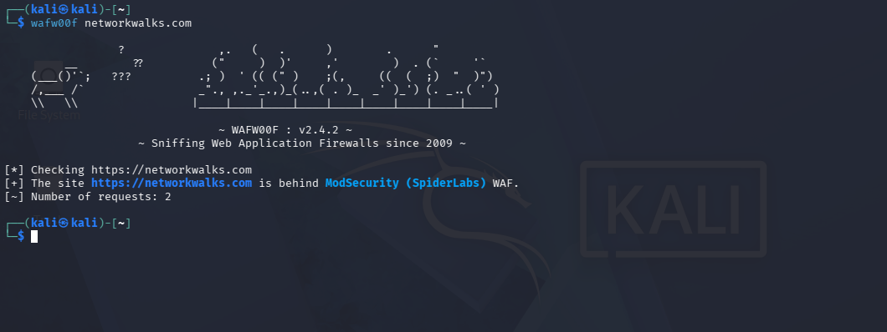

# 🛡️ Cybersecurity – Week 02

### Footprinting | Network Scanning | Penetration Testing

  <b>Networkwalks Cybersecurity Internship</b>

---

## 📌 Project Overview

This repository contains my Week 2 cybersecurity internship tasks and practical activities. During this week, I explored different footprinting and network scanning techniques and documented the observations in a penetration testing report.

## 🎯 Topics Covered

- Footprinting and Reconnaissance
- Domain Information Gathering
- DNS Enumeration
- Website Technology Detection
- HTTP Header Analysis
- Web Application Firewall Detection
- Network Discovery
- Nmap Scanning with Zenmap
- Network Topology
- Penetration Testing Documentation

## 🧰 Tools Used

| Tool | Purpose |
|---|---|
| Kali Linux | Security testing environment |
| WHOIS | Domain registration information |
| WhatWeb | Website technology identification |
| Nslookup | DNS lookup |
| DNSRecon | DNS enumeration |
| Curl | HTTP header analysis |
| Wafw00f | WAF detection |
| Nmap | Network scanning |
## 🔍 Nmap – Network Scanning Tasks

### Task 1: Download and Install Zenmap
Downloaded and installed Zenmap from its official website on Windows.

### Task 2: Identify Local IP and LAN Subnet
Identified the local IP address and LAN subnet.

### Task 3: Discover Live Hosts
Used network scanning to identify live hosts on the local subnet.

### Task 4: Count Live Hosts
Determined the total number of live hosts in the subnet.

### Task 5: Identify Live Hosts' IP Addresses
Observed the IP addresses of the discovered live hosts.

### Task 6: Identify MAC Addresses
Observed the MAC addresses of the discovered hosts.

### Task 7: Network Topology
Generated and saved the network topology in PDF format.

📄 [View Network Topology PDF](./65012_Week_1-2.pdf)

## 📸 Practical Screenshots

The following screenshots provide visual evidence of my practical activities.

## 📸 Practical Screenshots

### 01. Cutl-I

### 02. Whois 1

### 03. whois 2

### 04. Practical Evidence

### 05. DNSRecon

### 06. WhatWeb

### 07. Wafw00f

### 08. Network Topology

### 9. Nmap (Network Scanning)
Nmap was used to understand network scanning and identify information about network hosts.

## 📄 Penetration Testing Report

My detailed report includes:

- Activities Performed
- Tools and Commands
- Observations and Findings
- Risk Analysis
- Security Recommendations
- Supporting Evidence

📎 [View Penetration Testing Report](./Cybersecurity_Footprinting_and_Network_Scanning_Report_Muhammad_Akram_B084.docx)

## 📚 Learning Outcomes

Through these practical activities, I gained experience in domain reconnaissance, DNS enumeration, website technology identification, network discovery, and cybersecurity report writing.

## ⚠️ Disclaimer

All activities are intended for educational purposes and authorized security testing only.

---

## ✍️ Submitted By

**Muhammad Akram**  
Cybersecurity Intern | Networkwalks  
Batch B084

#CyberSecurity #Footprinting #NetworkScanning #PenetrationTesting #KaliLinux
